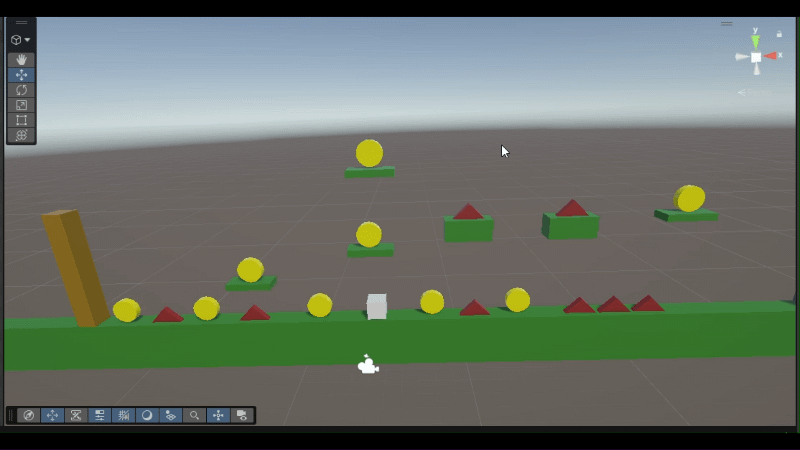

# Mini-level — Inleveren

**Naam:** Bryan Aberkrom 
**Klas:** SD1C
**Datum:** 23/10/2026 
**Les:** GDV Les 6

---

## Wat heb ik gemaakt?

Ik heb een heel simpel level gemaakt met goede player bewegingen, pain blocks en coins om optepakken.
het doel van het spel is om alle muntjes te verzamelen. zonder dat je dood gaat!

---

## Screenshot / GIF van je level



## Bewegend object

De cube beweegt op de X en Y as. ik heb dit gedaan door 
Vector3 direction = new Vector3 en float horizontal = Input.GetAxis("Horizontal"); te gebruiken.
voor de jump moest er ook gechecked worden of de cube wel op de grond stond. zodat hij niet kan vliegen!

...

```csharp
// Plak hier het script of het stuk code dat het object laat bewegen.
void Start()
{
    rb = GetComponent<Rigidbody>();
    Health = 100;
}

// Update is called once per frame

void Update()
{
    jump = Input.GetKeyDown(KeyCode.Space);

    float horizontal = Input.GetAxis("Horizontal");
    Vector3 direction = new Vector3(horizontal, 0, 0);
    rb.linearVelocity = new Vector3(
        direction.x * speed,
        rb.linearVelocity.y,
        direction.z * speed
        );

    if (Input.GetKeyDown(KeyCode.Space) == true && Grounded == true)
    {
        Debug.Log("Jumped");
        rb.linearVelocity = new Vector3(horizontal, JumpHeight, 0);
        Grounded = false;
    }
```

---

## Collider of trigger

De grond heeft een collider om te checken of je wel op de grond staat om nog een keer te kunnen springen.
en de coin heeft een trigger hierdoor, kan je door de coin lopen de de coin oppakken!

...

```csharp
// Plak hier de OnCollisionEnter/OnTriggerEnter code die je hebt gebruikt.

    void OnTriggerEnter(Collider other)
    {
        if (other.CompareTag("Player"))
        {
            Destroy(gameObject);
            Coins += 1;
            Debug.Log($"Aantal coins: [{Coins}]");
        }
    }
}

```

---

## Logica met `if` of `switch`

ik heb heel veel if gebruikt om bijvoorbeeld tevragen of de player wel op de grond staat voordat hij springt!

...

```csharp
// Plak hier het stuk code met jouw if- of switch-logica.
void OnCollisionEnter(Collision collision)
{
    if (collision.gameObject.CompareTag("Ground"))
    {
        Debug.Log("OpDeGrond");
        Grounded = true;
    }
    else
    {
        Grounded = false;
    }

```

---

## Eigen extra idee

1. ik heb de camera aan de player gezet waardoor de camera meegaat met de player.
2. ik heb een pain block toegevoegd waar de player health aan verliest en uiteindelijk dood kan gaan.
3. ik heb een tekstje toegevoegd zodat je niet alleen in de console kan zien maar ook in het spel zelf dat je wint of dood gaat!

...

```csharp
if (collision.gameObject.CompareTag("Pain"))
{
    
    onpainblock = true;
    Grounded = true;
    Debug.Log("onPainBlock");
    Health -= 20;
    Debug.Log($"Painblock -20 heath = {Health}");
    if (Health <= 0)
    {
        Debug.Log("Dood!");
        Destroy(gameObject);
    }
}
else
{
    onpainblock = false;
    
}

```

---

## Evaluatie

### Wat ging goed? en waarom?

de collision en trigger had ik snel al door waardoor dat super snel ging!
ik ben ook trots op dat ik bij de pain blocks de kleur heb laten veranderen!


### Wat vond je lastig?

ik vond het lastig om de materialen optevragen en te veranderen van de player en van andere gameobjecten.


### Wat zou je een volgende keer anders doen?

ik zou meer "Case" statements gebruiken om "if" te vervangen en om het meer overzichtelijker te maken

